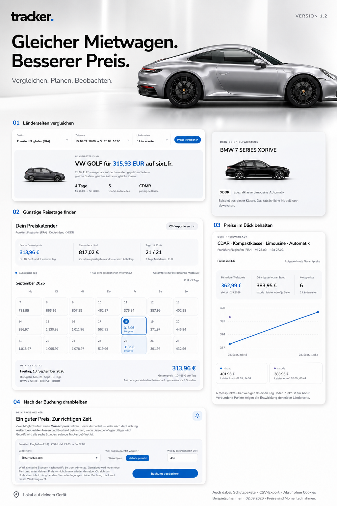
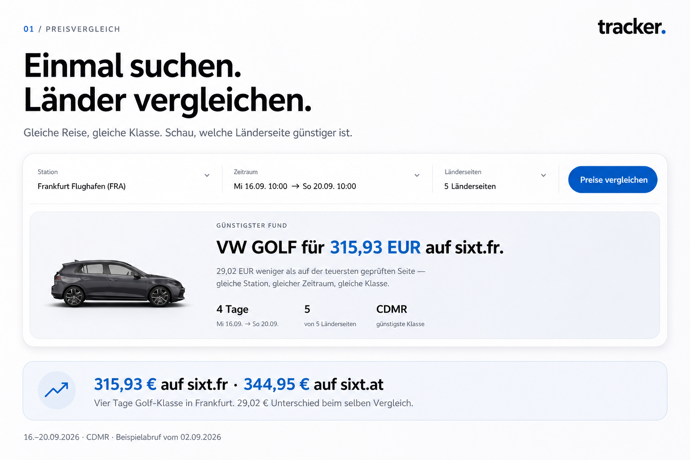
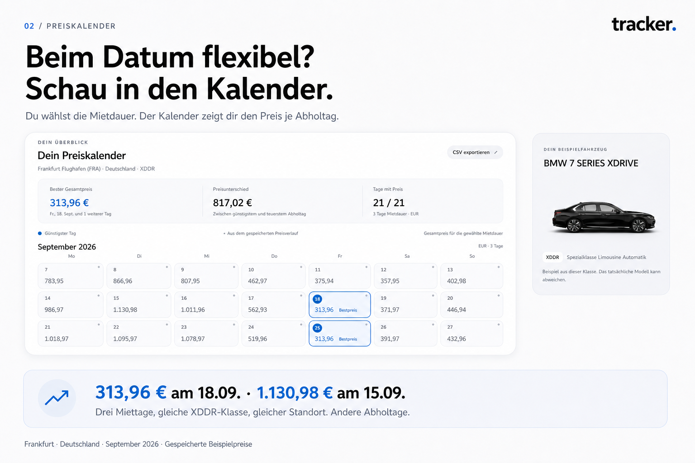
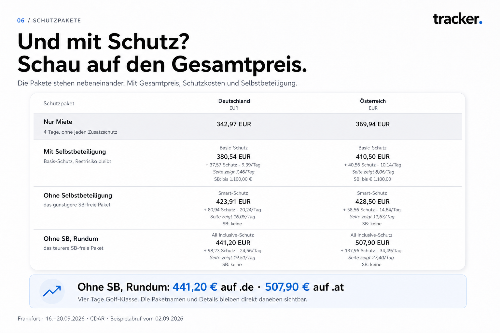
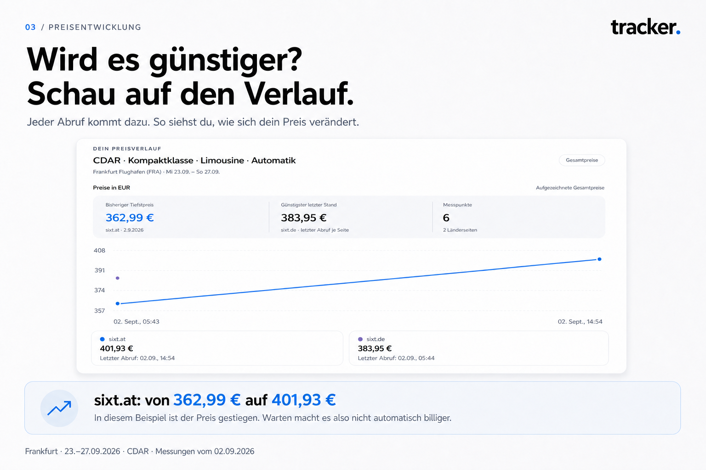
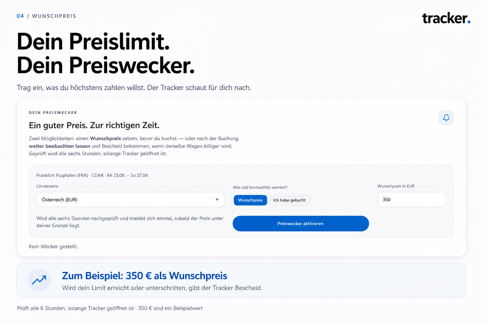
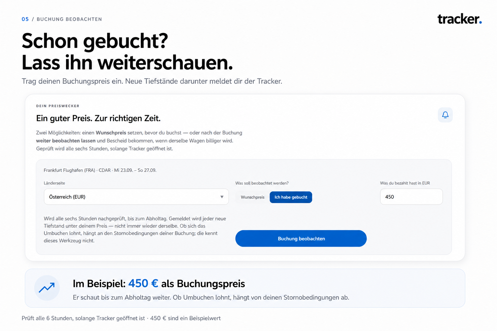

<div align="center">


# TRACKER

**Gleicher Mietwagen. Besserer Preis.**

Sixt verlangt für dieselbe Anfrage je nach Landesdomain unterschiedliche Preise.
TRACKER fragt alle Länderseiten gleichzeitig ab und stellt sie nebeneinander,
Fahrzeugklasse für Fahrzeugklasse, inklusive der Schutzpakete, die den Endpreis
wirklich bestimmen.

Ein Windows-Programm, das komplett auf deinem Rechner läuft. Kein Konto,
keine Anmeldung, keine Daten nach draußen.

</div>



---

## Inhalt

- [Was TRACKER beantwortet](#was-tracker-beantwortet)
- [Loslegen](#loslegen)
- [Die Funktionen im Einzelnen](#die-funktionen-im-einzelnen)
- [Was es nicht kann](#was-es-nicht-kann)
- [Selbst bauen](#selbst-bauen)
- [Wie das Repository aufgebaut ist](#wie-das-repository-aufgebaut-ist)
- [Stationsliste erweitern](#stationsliste-erweitern)
- [Datenherkunft, Lizenz, fremde Bestandteile](#datenherkunft-lizenz-fremde-bestandteile)

---

## Was TRACKER beantwortet

Vier Fragen, die ein Vergleichsportal nicht beantwortet, jede mit einer
gemessenen Antwort aus diesem Programm:

| Frage | Gemessen |
| --- | --- |
| **Auf welcher Länderseite ist es billiger?** | VW Golf, Frankfurt, 4 Tage: **315,93 €** auf sixt.fr gegen **344,95 €** auf sixt.at |
| **An welchem Tag ist es billiger?** | Frankfurt, gleiche Klasse, 3 Tage: **313,96 €** am 18.09. gegen **1.130,98 €** am 15.09. |
| **Zu welcher Uhrzeit ist es billiger?** | Köln, gleicher Tag, gleiche Klasse: **67,97 €** um 12:30 gegen **106,99 €** um 13:30 |
| **An welcher Station ist es billiger?** | Köln-Gremberghoven gegen Bonn Bad Godesberg, gleiche Reise: bei **37 von 37** Klassen günstiger, im Mittel **57,36 € (49,2 %)** |

Alle vier Zahlen stammen aus echten Abrufen, nicht aus einem Beispiel. Die
letzten beiden waren die größte Überraschung: **eine Stunde später abholen kann
mehr kosten als die Wahl der Länderseite**, und dieselbe Stadt hat Stationen,
die um die Hälfte auseinanderliegen.

---

## Loslegen

1. **[Tracker.exe aus den Releases herunterladen](../../releases/latest)**
2. Doppelklick. Es öffnet sich ein eigenes Programmfenster.
3. Station suchen, Zeitraum wählen, Länderseiten anhaken, **Preise vergleichen**.

Beim ersten Start prüft TRACKER einmal, ob auf deinem Rechner alles durchgeht:
Schreibrechte, Browser, Verbindung, Cookie-Hinweis und die Trefferliste, mit
echten Abrufen auf vier Länderseiten. Das dauert ein bis zwei Minuten und
erspart später das Rätselraten. Wenn alles läuft, lässt es sich abstellen.

### Zwei Dinge vorweg

**Chrome oder Edge muss installiert sein.** TRACKER startet für den Abruf ein
eigenes, unsichtbares Browserfenster. Ohne einen der beiden bleibt der
Link-Modus: die Suchen werden gebaut, geöffnet werden sie von Hand.

**Windows wird warnen.** Die EXE ist nicht signiert, ein Zertifikat kostet
mehrere hundert Euro im Jahr. SmartScreen meldet deshalb „Unbekannter
Herausgeber". Wer das nicht anklicken mag, hat eine bessere Möglichkeit als
Vertrauen: der komplette Quellcode liegt hier, und [selbst bauen](#selbst-bauen)
sind drei Befehle.

---

## Die Funktionen im Einzelnen

### 1 · Preisvergleich über 29 Länderseiten



Eine Suche geht gleichzeitig an bis zu 29 Sixt-Domains. Verglichen wird über den
**ACRISS-Code**, den international einheitlichen Vier-Buchstaben-Schlüssel für
die Fahrzeugklasse. Das ist nötig, weil dieselbe Klasse auf jeder Länderseite
anders heißt; der Code nicht. Sixt benutzt dabei drei eigene Buchstaben, die
nicht im Standard stehen. TRACKER kennt sie.

Verglichen wird nur **innerhalb derselben Währung**. Eine Umrechnung wäre eine
Zahl, die niemand nachprüfen kann, weil der Kurs am Tag der Abrechnung gilt und
nicht am Tag des Vergleichs.

> **Beispiel** · Frankfurt Flughafen, 16.–20.09., vier Tage, fünf Länderseiten.
> Günstigster Fund: VW Golf für **315,93 €** auf sixt.fr, 29,02 € weniger als
> auf der teuersten geprüften Seite, bei gleicher Station, gleichem Zeitraum und
> gleicher Klasse.

Dazu:
- **Mehrere Stationen und Termine gleichzeitig.** Datums-Matrix von −5 bis +5
  Tagen um den Stichtag, dazu beliebige Mietdauern.
- **Nicht buchbare Klassen bleiben als Zeile stehen** statt zu verschwinden.
  Sonst sähe man nicht, dass es die Klasse dort gibt, sie nur gerade weg ist.
- **Frühbucherrabatt wird ausgewiesen.** Er läuft nicht überall gleichzeitig;
  ohne den Hinweis wäre der Vergleich verzerrt.

### 2 · Stationen gegenübergestellt

Sind mehrere Stationen gewählt, entstehen Reiter, und man klickt hin und her.
Ein Kasten über den Reitern sagt stattdessen direkt, welche günstiger ist.

Gerechnet wird **paarweise über die Klassen, die es an allen Stationen gibt**,
nicht als Durchschnitt aller Angebote. Ein Durchschnitt führte in die Irre: eine
Station, die drei Luxuswagen im Katalog hat, bekäme den höheren Schnitt, auch
dann, wenn sie bei jeder gemeinsamen Klasse billiger ist.

> **Beispiel** · Köln Porz Gremberghoven gegen Bonn Bad Godesberg, gleiche
> Reise, drei Länderseiten:
> „Köln Porz Gremberghoven ist günstiger, bei **37 von 37** gemeinsamen
> Klassen. Bonn Bad Godesberg liegt im Mittel **57,36 EUR (49,2 %)** darüber."

Getrennt je Währung. Stationen ohne Ergebnis werden benannt, nicht
stillschweigend weggelassen, sonst wüsste man nicht, dass eine fehlt.

### 3 · Uhrzeiten, der unterschätzte Hebel

Sixt rechnet nach Uhrzeit ab, nicht nach Kalendertag. Das schlägt härter durch
als jede Länderseite, und kaum jemand prüft es.

> **Beispiel** · Köln-Gremberghoven, Samstag, drei Tage, günstigste Klasse,
> zweimal unabhängig gemessen, identisches Ergebnis:
>
> | Abholung → Rückgabe | Preis |
> | --- | --- |
> | 12:30 → 12:30 | **67,97 €** |
> | 13:30 → 13:30 | **106,99 €** |
> | 13:30 → 08:00 | **72,99 €** |
>
> Eine Stunde später: **57 % mehr.** Früher zurückgeben holt fast alles zurück.

Die Richtung wechselt je Datum, am 4. September war dieselbe Station um 13:30
**billiger** (149,99 € gegen 172,97 €). Genau deshalb lohnt das Nachsehen statt
einer Faustregel.

Abhol- und Rückgabezeit lassen sich getrennt setzen; jedes Paar ist eine eigene
Abfrage mit eigenem Reiter. Auch im Kalender: dort zeigt jeder Abholtag die
günstigste seiner Uhrzeiten, und die Tagesansicht listet alle auf, günstigste
zuerst, mit dem Aufschlag daneben.

### 4 · Preiskalender, wann ist es billig?



Du wählst Station, Länderseite, Fahrzeugklasse und Mietdauer; der Kalender
rechnet jeden Abholtag einzeln durch und zeigt den Gesamtpreis je Tag. Bis zu
56 Abholtage am Stück, Mietdauer 1 bis 30 Tage als Vorschlag und darüber hinaus
frei eintragbar bis 90.

> **Beispiel** · Frankfurt Flughafen, dreitägige Miete, September 2026:
> **313,96 €** am günstigsten Tag, **1.130,98 €** am teuersten. 817,02 €
> Unterschied allein durch den Abholtag, gleiche Station, gleiche Klasse,
> gleiche Dauer.

- **Die Fahrzeugklasse steht direkt über dem Kalender** und lässt sich dort
  wechseln, ohne zum Formular zurückzuscrollen. Der Wechsel kostet keinen
  neuen Abruf, die Angebote aller Klassen stecken schon im Ergebnis. Daneben
  steht, an wie vielen Tagen es die Klasse überhaupt gibt („an 6 von 28 Tagen
  verfügbar"), damit ein fast leerer Kalender nicht wie ein Fehler aussieht.
- Ein Klick auf einen Tag zeigt den genauen Preis, den Rückgabetag und ein
  Beispielfahrzeug der Klasse.
- Woher ein Wert stammt, steht dran: frischer Abruf oder gespeicherter
  Preisverlauf, samt Alter der Messung. Ein Punkt am Tagesfeld markiert die
  gespeicherten.
- Liegen alle Tage vor, wird aus dem Knopf **„Alle Tage neu messen"** statt
  eines toten Knopfes.
- Der Kalender zeigt **Grundpreise ohne Schutzpaket**, er beantwortet „wann",
  nicht „mit welchem Schutz". Ein Knopf am Tag übernimmt Station und Zeitraum in
  den Preisvergleich, wo der Schutz mit echtem Kassenpreis danebensteht.

### 5 · Mehrere Stationen über einen ganzen Zeitraum

Eigener Bereich im Kalender: denselben Zeitraum an mehreren Stationen
durchrechnen. Gewertet wird über die Abholtage, die an **allen** Stationen einen
Preis haben, sonst verglichen sich zwei verschiedene Zeiträume.

> **Beispiel** · Bonn gegen Köln über sieben Abholtage:
> „Köln Porz Gremberghoven ist im Schnitt am günstigsten, **161,68 €** je drei
> Tage, und an **5 von 7** Tagen die billigste. Bonn Bad Godesberg liegt im
> Schnitt 39,86 € (24,7 %) darüber, **ist aber an 2 Tagen die billigste.**"

Der Bereich sagt vorweg, wie lange es dauert (drei Stationen über 28 Abholtage
sind 84 Abrufe, gut zehn Minuten), fasst Ausfälle automatisch einmal nach und
benennt, was danach fehlt. Abbrechen geht jederzeit; das schon Geholte bleibt.

### 6 · Schutzpakete mit echtem Endpreis



Das ist die Stelle, an der die meisten Vergleiche falsch liegen. TRACKER klickt
**jedes Paket in der Kasse einzeln an und liest die Gesamtsumme ab**, statt den
angezeigten Tagespreis mit den Miettagen zu multiplizieren. Gemessen lagen
beide Wege bis zu **26 %** auseinander.

Zugeordnet werden die Pakete über ihren **Inhalt**. Selbstbeteiligung ja/nein,
günstiger/teurer, , nicht über den Namen: der heißt auf jeder Länderseite
anders. Der jeweilige Originalname steht klein über dem Preis, damit die
Zuordnung nachprüfbar bleibt.

> **Beispiel** · Frankfurt, vier Tage, Golf-Klasse:
> „Ohne SB, Rundum" kostet **441,20 €** auf sixt.de und **507,90 €** auf
> sixt.at. Die reine Miete lag bei 342,97 € gegen 369,94 €, der Schutz
> verschiebt den Abstand also deutlich.

### 7 · Preisentwicklung, wird es billiger, wenn ich warte?



Jeder Abruf hinterlässt einen Messpunkt. Daraus entsteht eine Kurve je
Länderseite, die Frage, die kein Vergleichsportal ehrlich beantwortet.

Getrennte Reihen für alles, was den Preis ändert, **ohne dass Sixt etwas geändert
hätte**: je Länderseite, je Abrufmodus (mit/ohne Cookies) und je Uhrzeit. In eine
Linie gelegt sähe jeder Wechsel aus wie eine Preisänderung.

> **Beispiel** · Die Kurve zeigt auch das Gegenteil der Erwartung: sixt.at stieg
> im Beobachtungszeitraum von 362,99 € auf 401,93 €. **Warten macht es nicht
> automatisch billiger.**

### 8 · Preiswecker, zwei Sorten



**Wunschpreis**, vor der Buchung. Du trägst ein, was du höchstens zahlen
willst; TRACKER prüft alle sechs Stunden nach und meldet sich einmal, sobald der
Preis darunter liegt.



**Ich habe gebucht**, nach der Buchung. Du trägst ein, was du bezahlt hast.
TRACKER beobachtet bis zum Abholtag weiter und meldet **jeden neuen Tiefstand
darunter**, mit der Ersparnis in der Meldung, und nicht immer wieder denselben
Preis. In der Liste steht die eine Zahl, die zählt: „Zurzeit 38,40 € billiger als
gebucht."

Beide prüfen zu **deiner** Uhrzeit, nicht zu einer festen, bei 57 % Spanne
zwischen zwei Abholzeiten wäre alles andere ein falscher Alarm.

> **Ehrliche Einschränkung:** geprüft wird nur, solange TRACKER geöffnet ist. Es
> installiert nichts, das im Hintergrund weiterläuft. Für „täglich nachschauen"
> heißt das: einmal am Tag starten. Ob sich Umbuchen lohnt, hängt an den
> Stornobedingungen deiner Buchung, die kennt dieses Werkzeug nicht.

### 9 · Excel-Ausgabe

Eine echte `.xlsx` mit Kopfblock (Station, Zeitraum, Abrufmodus, Zeitpunkt),
fixierter Kopfzeile, Autofilter und festen Spaltenbreiten. Beträge sind **Zahlen
mit Währungsformat**, kein Text, man kann direkt darüber rechnen. Der günstigste
Wert je Zeile ist hervorgehoben, eine Farbskala liegt über den Gesamtpreisen.
Ein Blatt je Währung.

Wählbar sind Preistabelle, Schutzpakete, Monatsübersicht, alle Stationen statt
nur der gezeigten, nicht buchbare Klassen und ob Gesamt-, Tages- oder beide
Preise hineinsollen. Die schlichte CSV-Ausgabe bleibt als kurzer Weg daneben.

### 10 · Abruf ohne Cookies

Ein Haken beim Preisvergleich und im Kalender: dann wird jede Länderseite mit
einem frisch geleerten Profil angesehen, als käme man zum ersten Mal.

Was dabei herauskam, spricht **gegen** die verbreitete Annahme, Cookies machten
den Preis teurer. Frankfurt: ohne Cookies rund 4 % billiger. Bonn und Köln über
je 56 Abholtage: ohne Cookies 9 € bzw. 5 € **teurer**, und in beiden Fällen war
der günstigste Abholtag exakt derselbe. Die Richtung wechselt, die Größenordnung
liegt im Rahmen dessen, was sich zwischen zwei Abrufen ohnehin bewegt.

Der Haken bleibt trotzdem: er macht die Frage nachprüfbar, statt sie zu
behaupten.

### 11 · Kleinigkeiten, die den Alltag ausmachen

- **2250 Stationen aus 108 Ländern**: Flughäfen, Bahnhöfe, Stadt-, Hotel-,
  Hafen- und Agenturstationen. Suchfeld mit Umlaut- und IATA-Erkennung:
  `munchen`, `FRA` und `heathrow` finden alle das Richtige.
- **Einweg-Miete** direkt in der Stationsauswahl.
- **Zuletzt verglichene Fahrzeuge** mit Preis- und Schutztabelle und einem
  Notizfeld je Eintrag.
- **Stationen anschreiben:** E-Mail-Adressen der gewählten Stationen sammeln und
  ins BCC-Feld übernehmen.
- **Abbrechen** mitten im Abruf; das schon Geholte bleibt.
- **Alles zurücksetzen** auf wirklich null, keine Station, keine Länderseite,
  keine Matrix, keine Ergebnisse.
- **Automatische Wiederholung.** Scheitert eine Länderseite, wird sie bis zu
  dreimal neu angestellt, hinten in der Warteschlange, damit die anderen nicht
  warten. Was übrig bleibt, steht als Kennung in der Zelle (`ZUGRIFF`,
  `STATION`, `KEINE_LISTE`, `NETZ`, `ZEIT`) mit Klartext und Rat im Tooltip. Ist
  der Durchlauf durch und fehlt trotzdem etwas, fasst die Oberfläche einmal von
  selbst nach.
- **Systemstatus** („Was geht gerade?") mit Selbsttest, Zahlen dieses Rechners
  und dem Schalter für die Begrüßung.

---

## Was es nicht kann

Ehrlich aufgelistet, damit niemand danach sucht:

**Kein Login.** Sixt-Zugangsdaten werden nirgends abgefragt, gespeichert oder
verwendet. Damit fehlen Statuspreise für Gold, Platin und Diamond, gezeigt wird
der Preis, den ein nicht angemeldeter Besucher sieht.

**Keine Währungsumrechnung.** Verglichen wird nur innerhalb derselben Währung.

**Kein Hintergrunddienst.** Der Preiswecker prüft nur, solange das Programm
läuft. Es trägt sich nicht in den Autostart ein und lässt nichts zurück.

**Zwei Länderseiten sind zurzeit aus.** `sixt.cz` und `sixt.com.tr` nehmen eine
deutsche Station nicht an. Gemessen: vier von vier Abrufen ohne Ergebnis. Sie
stehen sichtbar als gestört in der Auswahl, mit Begründung, statt kommentarlos zu
verschwinden.

**Ergebnisse verfallen nach einer Stunde.** Sie liegen im Arbeitsspeicher. Was
dauerhaft bleibt, ist der Preisverlauf für die Kurve.

**Es bricht, wenn Sixt umbaut.** Dann meldet der Eintrag den Grund, statt still
falsche Zahlen zu zeigen. Das ist Absicht: eine falsche Zahl ist schlimmer als
gar keine.

**Keine Tarnkappen-Technik.** TRACKER gibt sich nicht als etwas anderes aus, als
es ist, und umgeht keine Sperren. Cookie-Banner werden mit *Ablehnen*
beantwortet, nie mit *Einverstanden*.

---

## Selbst bauen

Voraussetzung: [Node.js](https://nodejs.org) 20 oder neuer.

```bash
git clone https://github.com/Shaineless/mietwagen-tool.git
cd mietwagen-tool
npm install
```

**Als Programmfenster starten** (baut und startet den lokalen Dienst):

```bash
npm run serve
```

**Die einzelne EXE bauen**, das Ergebnis liegt danach in `dist/Tracker.exe`:

```bash
npm run exe
```

**Nur die Oberfläche bauen**, erzeugt `dist/mietwagen-preistool.html`, eine
einzelne Datei, die sich ohne Dienst im Browser öffnen lässt (dann ohne
automatischen Preisabruf):

```bash
npm run build
```

---

## Wie das Repository aufgebaut ist

Der Quellcode ist in Module aufgeteilt, aber das Ergebnis ist **eine einzige
HTML-Datei**: `build.mjs` löst die Importe auf und schreibt alles zusammen,
Skript, Stile, Stationsliste und Bilder als eingebettete Daten. So läuft die
Oberfläche auch ohne Server direkt von der Festplatte.

### Oberfläche, `src/`

| Datei | Wofür |
| --- | --- |
| `index.html` | Grundgerüst aller Bildschirme: Start, Preisvergleich, Kalender, Preisentwicklung, Schutz, Verlauf, Systemstatus, Begrüßung |
| `styles.css` | Die gesamte Darstellung. Ein heller, ruhiger Entwurf mit Farbtokens |
| `app.js` | Das Herzstück: Zustand, Auftragsbau, Tabellen, Kalender, Preiswecker, Stationsvergleich, alle Bildschirme |
| `xlsx.js` | Schreibt Excel-Mappen. ZIP und XML von Hand, ohne Fremdbibliothek |
| `providers.js` | Anbieter-Adapter: URL-Bau je Länderseite, Währung, Status (auch „gestört") |
| `offer-classes.js` | ACRISS-Decoder, inklusive der drei Buchstaben, die Sixt zusätzlich verwendet |
| `offer-parse.js` | Wertet die Angebotskacheln aus. Einzige Quelle, der Build verteilt sie an Erweiterung und Dienst |
| `places.js` | Ortsebene, vorbereitet für den Vergleich mehrerer Anbieter |
| `data/stations.sixt.txt` | Die Stationsliste als schlichte Textdatei, von Hand erweiterbar |
| `stations.js` | Vom Build erzeugt, nicht bearbeiten |
| `bilder/` | Wortmarke und das Fahrzeugmotiv der Startseite |

### Dienst und Abruf, `tools/`

| Datei | Wofür |
| --- | --- |
| `serve.mjs` | Der lokale Dienst: liefert die Oberfläche aus, führt die Warteschlange, beantwortet die API, deutet Fehler und wiederholt |
| `browser.mjs` | Startet Chrome und verbindet sich damit. Cookie-Banner, störende Fenster, das getrennte Profil für den Abruf ohne Cookies |
| `scrape/sixt.mjs` | Liest die Preisliste einer Länderseite aus |
| `scrape/sixt-schutz.mjs` | Klickt die Schutzpakete in der Kasse durch und liest die Endsummen |
| `scrape/offer-parse.mjs` | Vom Build erzeugte Kopie des Parsers, nicht bearbeiten |
| `katalog.mjs` | Merkt sich dauerhaft, welche ACRISS-Klassen es an welcher Station gab |
| `beobachtung.mjs` | Legt je Abruf einen Messpunkt ab (`preisverlauf.jsonl`), die Grundlage der Preiskurve |
| `wecker.mjs` | Preiswecker: anlegen, fällige finden, Prüfung vermerken, auslösen |
| `selbsttest.mjs` | Prüft die ganze Kette auf einem fremden Rechner, Schritt für Schritt mit Rat |
| `pfade.mjs` | Wo gelesen und geschrieben wird, im Quellbaum anders als in der EXE |
| `fenster.mjs` | Das Programmfenster (Chrome oder Edge im `--app`-Modus) samt Lebenszeichen |
| `meldung.mjs` | Protokolldatei und Meldungsfenster, damit die EXE ohne Konsole auskommt |
| `try-*.mjs` | Handproben für die Entwicklung: eine Preisliste, die Schutzpakete, alle Länderseiten, ein Popup-Test |
| `harvest-sixt.md` | Anleitung, wie man Stationen nachlädt |
| `README-preise.md` | Warum der Preisabruf über ein selbst gestartetes Chrome läuft und welche Alternativen daran gescheitert sind |

### Browser-Erweiterung, `extension/`

Optional und nicht nötig für den normalen Gebrauch. Sie kann Preise aus einem
offenen Tab an den Dienst melden. Nützlich, wenn der automatische Abruf einmal
nicht durchgeht.

### Bauen

| Datei | Wofür |
| --- | --- |
| `build.mjs` | Bündelt Module, Stile und Stationen zu einer HTML-Datei und verteilt den Parser |
| `build-exe.mjs` | Baut daraus die einzelne Windows-EXE (Node-Laufzeit eingebettet, ohne Konsolenfenster) |
| `Preistool starten.cmd` | Bauen, Dienst starten, Fenster öffnen, in einem Doppelklick |

### Was **nicht** im Repository liegt

`data/preisverlauf.jsonl`, `data/wecker.json` und die übrigen Betriebsdaten
entstehen beim Benutzen und sind auf jedem Rechner andere. Ebenso `build/` und
die fertige EXE: eine 96-MB-Binärdatei gehört nicht in die Versionsverwaltung,
weil Git jede Fassung für immer behält und jeder, der klont, alles davon
herunterlädt. Sie liegt bei den **Releases**.

Der `data/acriss-katalog.json` bleibt bewusst drin, er ist mühsam gesammeltes
Wissen darüber, welche Klassen es wo gibt.

---

## Stationsliste erweitern

`src/data/stations.sixt.txt` ist eine schlichte Textdatei:

```
id|land|iata|name
110|DE|FRA|Frankfurt Flughafen (FRA)
168|DE||München Hauptbahnhof
```

Die `id` ist Sixts numerische Stations-ID (der `uci`-Parameter). Woher man sie
bekommt, steht in [tools/harvest-sixt.md](tools/harvest-sixt.md). Der Build
meldet Dubletten.

---

## Datenherkunft, Lizenz, fremde Bestandteile

**Datenherkunft.** Die Stations-IDs stammen aus den öffentlichen, für
Suchmaschinen freigegebenen Stationsseiten auf sixt.de, wo sie im Seitenquelltext
stehen. Es wurde keine interne Schnittstelle angezapft. Fahrzeugbilder und Preise
stammen von Sixt und werden abgelesen, nicht verändert.

**Unabhängigkeit.** TRACKER ist ein unabhängiges Werkzeug und **kein Angebot der
Sixt SE**. Es besteht keine Verbindung zum Unternehmen. Keine Logos, keine
Nachbildung der Originalseiten.

**Preise sind Momentaufnahmen.** Sie ändern sich laufend. Verbindlich ist immer
nur, was am Ende in der Kasse steht.

**Lizenz.** MIT, siehe [LICENSE](LICENSE).

**Fremde Bestandteile.** In der EXE stecken:

| Bestandteil | Lizenz |
| --- | --- |
| [Node.js](https://nodejs.org) | MIT |
| [Playwright](https://playwright.dev) | Apache 2.0 |

Beide verlangen, dass ihre Lizenz bei einer Weitergabe beiliegt, auch bei einer
Binärdatei. Chrome beziehungsweise Edge wird nicht mitgeliefert, sondern das auf
dem Rechner vorhandene benutzt.

---

<div align="center">

**Vergleichen. Planen. Losfahren.**

</div>
